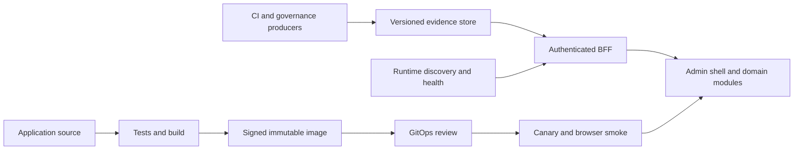

<!-- SPDX-License-Identifier: Apache-2.0 -->
# Admin UI delivery and trustworthy operational evidence

Status: proposal for incremental implementation. This document does not authorize
changes to deployment approvals or replace the existing governance rules.

The admin console should let an operator make the right decision quickly. That
requires both fresh software and truthful data. Separate application releases,
operational evidence updates, and domain modules so that updating a test result
does not require compiling and deploying the entire console.

## Existing constraints

The application is a Next.js app with a server-side BFF. The deployment workflow
waits for exact-source validation, stages multiple evidence collections, builds
and signs an image, and opens a GitOps PR. Its triggers include UI source,
governance documents, performance plans, and CI completion events. The Dockerfile
bundles operational data alongside code and has several collectors that copy the
repository context. These dependencies couple the freshness of data to delivery
of executable code.

The CI workflow already caches `.next/cache` and reuses its production build for
Playwright through `OPENBANK_E2E_PREBUILT`. Preserve these optimizations. The
container build is a separate compilation: a host-side compiler cache does not
automatically reach that build. The build script currently supplies no external
BuildKit cache arguments. Measure cache reuse before assuming all layers rebuild.

Relevant sources: `openbank-admin-ui/Dockerfile`,
`openbank-admin-ui/playwright.config.ts`, `.github/workflows/ci.yml`,
`.github/workflows/admin-ui-deploy.yml`, and
`openbank-infra/scripts/build-push-admin-ui.sh`.

## Three independent update paths

**Application:** build the deployable artifact once from an authorized revision;
run browser checks against that artifact; scan, sign and attest its digest; then
promote the same digest through environments. Separate an unprivileged build
from the privileged publisher, and verify producer workflow, source revision,
dependency lock and artifact digest at that boundary. No untrusted PR code gets
publisher credentials. Native dependencies must match the runtime architecture;
a build produced on one architecture is not automatically a portable image.

**Evidence:** publish immutable snapshots independently of the UI image. Start
with one bounded dataset, such as test results. Include schema version, producer
revision, run and attempt, collection time, expiry, completeness and content
digest. Keep historical versions and update a small current pointer atomically
only after validation. Reject incompatible schemas and preserve the last verified
snapshot with a stale label. The BFF enforces operator permissions and serves
cached projections; browsers receive neither infrastructure credentials nor
direct store access. Evidence updates cannot change executable code or grant
permissions. Rollback selects a compatible earlier snapshot without rebuilding.

**Runtime health:** collect inventory and readiness independently of slow version
or governance enrichment. Cache and coalesce concurrent read requests with a
bounded TTL and explicit observation time. Discovery must distinguish partial
namespace coverage from an empty successful inventory. A discovery failure must
not silently fall back to local service addresses in a cluster. Preserve separate
states for healthy, degraded, unreachable, intentionally idle, unknown and absent
observations. A missing observation is never evidence of an outage or of health.

## Modular architecture

Keep a single shell owning login, permissions, navigation, localization, design
tokens, error boundaries and telemetry. Divide features into domain modules such
as operations, payments, customers, product studio and governance. Each owns its
routes, typed API adapter, state transitions, tests and named maintainer. Enforce
import boundaries: modules use published contracts and shared UI primitives,
not sibling internals. Load expensive charts, editors and diagrams on demand.

Begin with packages and route boundaries in the existing application. Introduce
independently deployed route zones only when measured build cost or independent
release ownership justifies the additional authentication, navigation and
compatibility burden. Define the shared shell contract, asset prefixes and
cross-zone links before splitting a zone. Avoid a separate frontend deployment
for each backend service: operator journeys often cross many services.

Next.js documents independent route applications through
[multi-zones](https://nextjs.org/docs/app/guides/multi-zones).
For rolling deployments, validate asset retention and version skew handling;
[deploymentId](https://nextjs.org/docs/app/api-reference/config/next-config-js/deploymentId)
is one supported mechanism, not a substitute for deployment tests.

## Delivery optimization

Measure queue time, source-validation wait, generators, dependency installation,
compilation, browser tests, image publication, signing, GitOps review and rollout
separately. Record source revision and image digest throughout. A successful
build is not proof that an operator can use that revision.

Replace repeated polling for CI completion with a trusted artifact handoff when
the exact revision has passed its required checks. Retain exact-source validation;
do not substitute the latest unrelated green build. Generate deterministic inputs
once and reuse them. Use dependency-aware validation for affected modules while
retaining shell, authentication and critical journey coverage on every change.

Keep Docker inputs narrow, separate stable dependencies from changing data, and
reuse an external BuildKit cache scoped to the dependency lock, runtime platform
and trusted producer. Treat cache as an optimization, never as verification.
[Docker's cache guidance](https://docs.docker.com/build/cache/optimize/) covers
context size, layer ordering, cache mounts and external caches.

Serialize publication and GitOps promotion, coalesce superseded work before it
enters that boundary, and let image publication finish signing and attestation.
Cancelling a push between publication and attestation is unsafe. Required review
and checks remain in place; optimize duplicate work and review handoffs.

## Preventing misleading UI

Use a shared data-state contract: loading, verified empty, ready, stale, denied,
unavailable and malformed. Keep this distinct from the service's health status.
Every operational panel exposes its observation time and source. Summary counts
must use the same sample and classification as the rows. Optional data failures
must not discard successful primary observations. Unknown values use neutral
presentation; red and green require evidence. Announce refresh failures without
moving keyboard focus, and provide a reachable retry action.

Test the rendered decision, not merely whether a page mounts. Each critical
panel needs cases for valid data, genuine outage, empty inventory, timeout,
401/403, 503, invalid schema, partial failure, stale data and recovery. Add
deterministic visual and accessibility checks across desktop/mobile, Czech/English
and light/dark themes. Browser tests with mocked BFF responses verify UI behavior;
an authenticated, read-only deployed smoke verifies discovery, permissions and
real data against the deployed digest. Keep those proofs separately identifiable.

## Incremental acceptance plan

| Phase | Scope | Acceptance condition |
| --- | --- | --- |
| 1 | Correct health evidence rendering | Collector failure produces no fabricated DOWN rows; stale data is labelled; optional metadata cannot block health; regression tests fail against the old code. |
| 2 | Establish delivery baseline | Collect at least 30 actual releases; separate skipped runs, queues, validation, compilation, review and rollout; publish p50/p95 with sample count. |
| 3 | Extract one evidence dataset | Updating evidence causes zero application builds; authorization, schema rejection, stale handling and pointer rollback are exercised. |
| 4 | Reuse the tested artifact | Browser-tested digest equals promoted digest; cache hits improve measured build time without skipping verification. |
| 5 | Enforce feature boundaries | Cross-module imports use explicit contracts; affected checks retain shell and critical journey tests; split a route zone only with measured benefit. |

Initial engineering targets, to be calibrated against phase 2: PR feedback p95
under 8 minutes; approved source to canary p95 under 10 minutes excluding human
review (report that wait separately); live evidence age p95 under 30 seconds;
CI evidence visible within 2 minutes of publication; rollback under 2 minutes.
These are targets, not current achievements or a promise. Track change failure
rate, recovery time and operator task success alongside speed so faster delivery
does not reward unreliable software.

Each phase is independently reversible. Preserve the current bundled evidence
as an explicitly timestamped fallback during migration, with one authoritative
source selected per dataset. Remove that fallback only after compatibility,
failure and rollback tests pass. Broader discovery semantics and the evidence
store require their own contract review; phase 1 changes only client behavior.
