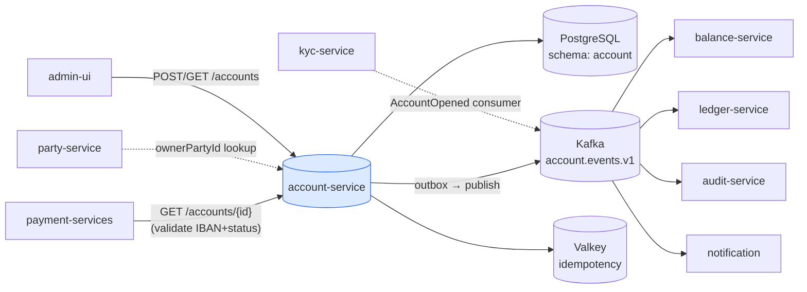
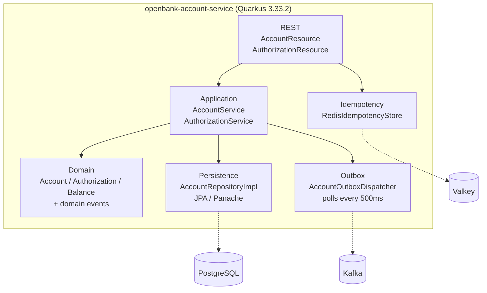
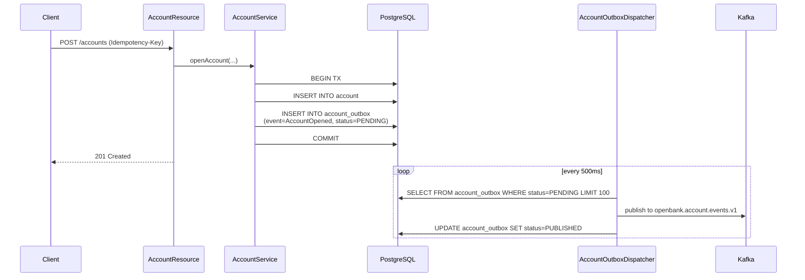

# Architecture

## C4 — System Context



## C4 — Container (internal structure)



## Hexagonal layers

The directory structure reflects **ports-and-adapters**:

```
com.openbank.account/
├── domain/                    ◄── core — no framework dependencies
│   ├── model/                 Account, AccountAuthorization, AccountBalance
│   ├── event/                 AccountOpened, AccountFrozen, …
│   ├── repository/            AccountRepository (port)
│   └── service/               domain logic (state transitions, invariants)
│
├── application/               ◄── use-case orchestration
│   ├── port/                  inbound / outbound ports
│   └── usecase/               AccountService, AuthorizationService
│
└── infrastructure/            ◄── adapters
    ├── rest/                  JAX-RS resources, DTO mapping
    ├── persistence/           AccountRepositoryImpl (JPA/Panache)
    ├── outbox/                AccountOutboxDispatcher (scheduled)
    ├── messaging/             Kafka producer
    ├── idempotency/           Redis adapter
    └── config/                @Produces beans
```

**Dependency rule:** `domain` ← `application` ← `infrastructure`. Domain code never sees JPA, Kafka, or REST DTOs.

## Outbox flow



**Why outbox:** transactional consistency between the DB write and Kafka publish. At-least-once delivery, idempotent consumers.

## Components from `openbank-libs`

| Module | Use here |
|---|---|
| `libs.domain.account.Iban` | IBAN validation + normalization |
| `libs.domain.money.Money` + `CurrencyCode` | values for initial balance, limits |
| `libs.domain.identifiers.AccountId` | typesafe ID instead of UUID |
| `libs.idempotency.IdempotencyStore` | Redis-backed implementation |
| `libs.persistence.outbox` | OutboxEntity, OutboxRepository, OutboxDispatcherBase |
| `libs.security.BootstrapVerifier` — ⬜ **not consumed, does not exist** | **Nothing.** This class is not in `openbank-libs` and never was (`git grep BootstrapVerifier -- '*.kt'` returns 0); ADR-0017 prescribes it and its own delivery note records that it was not shipped. Dev passwords are kept out of prod by ESO/OpenBao `secretKeyRef` injection (ADR-0007), not by libs code (#8426) |
| `libs.web.ServiceInfoResource` | `/api/v1/info` (build metadata) |
| `libs.docs.DocsResource` | **this documentation** (`/q/openbank/docs`) |
| `libs.util.BuildInfo` | runtime tech-stack snapshot |

## Principles

1. **Aggregate boundary = Account** — operations on an account are atomic; authorizations are child entities.
2. **Domain events first** — every state change emits a domain event; infrastructure serializes it.
3. **No remote calls in TX** — everything synchronous within request-response, async via outbox + Kafka.
4. **Idempotence at edge** — mandatory `Idempotency-Key` on all POST/PUT, deduplication in Redis.
5. **PII minimisation** — IBAN is PII (GDPR), masked in logs (`libs.security.PiiMask.maskIban`).

## Ownership-verification projection (ADR-0335 D2)

`POST /api/v1/accounts/ownership-verifications` (action `account.verifyOwnership`) takes
`{iban, partyId}` in the body and answers only `{owned, active}`, plus `accountId` when `owned` is
true. An unknown IBAN and another party's IBAN both answer `owned=false`, so the endpoint is not an
existence oracle. Its declared callers are pension-service and sdd-service; neither holds
`account.read`.

## Delegation authority facts (ADR-0375 D1)

`GET /api/v1/accounts/{accountId}/delegation/authority-facts` (action `account.read`) answers with
the ACTIVE, in-window, ACCOUNT-scoped grants a party holds over the account: grant id, grantor,
capabilities, validity window.

It sits next to `delegation/payment-authorization`, which answers the whole question, and the
difference is the point. That endpoint hard-codes `PAYMENT_ONLY`, which is right for the edge
pre-flight it was built for and structurally wrong for a payment rail's admission chain: the
chain's authority step is a pure function whose **capability is an argument**, so a rail asking
about the capability its own action names cannot be served by a fixed verdict. Handing over the
facts lets one pure kernel (`DelegatedDebitAuthority` in `openbank-libs-fincrime`) serve every rail.

Ownership is applied here and cannot be pushed to the caller: a projection row keyed on
(accountId, granteePartyId) alone is authority in itself, and the caller does not know the account's
owner. Resource type is pinned to `ACCOUNT`, so a `SAVINGS_GOAL` grant is never read as account
authority.

An unknown account answers `200` with an empty list, never `404` — a distinguishable not-found would
make the endpoint an existence oracle for other people's accounts.

**Stated gap.** These are grants only. The legacy `account_authorizations` arm that
`authorizeDelegatedPayment` still ORs in is not represented, so a party permitted solely by a legacy
row is absent from these facts. That divergence is already measured by the dual-run disagreement
counter rather than being discovered later from a refusal.

### The owner travels with the grants

The response carries `ownerPartyId` alongside the grants. The authority decision compares the actor
with the account owner *before* it consults any grant, so both must come from one snapshot: a caller
that resolved the owner through a separate lookup could decide the owner case against one read while
its own write-time proof compares another, and nothing observes the window between them. It also
removes a round trip from a path that already calls this service more than once per delegated
payment. `ownerPartyId` is null exactly when the account is unknown — where `grants` is empty too,
so the pair stays indistinguishable from an existing account with no grant for the party.

## Delegation grant projection (ADR-0232 D3, ADR-0375 D2)

`DelegationEventConsumer` keeps this service's own compacted projection of the `delegation-events`
stream, so an account operation decides a delegated caller's authority locally and never calls
delegation-service on the request path.

The envelope is no longer parsed here. `com.openbank.libs.delegation.DelegationGrantEventDecoder`
decodes it, `DelegationGrantEvents.ENABLING` / `DISABLING` classify the effect, and this consumer
keeps only the part that is genuinely local: which fields of the grant it stores, and what it does
with a record the decoder rejects. A `null` decode is a poison pill, not an empty grant.

One field stays at the use site on purpose: a grant arriving with no `approvalPolicy` is stored as
`APPROVAL_POLICY_SOLO`. That default is this service's reading of a missing value, not a property of
the wire format, so it does not belong in the shared decoder.

Before the shared decoder, the first nine lines of this consumer were character-for-character
identical to card-issuance-service's. Both were green and nothing compared them, so a producer-side
rename would have silently stopped one projection from matching — which leaves a revoked grant
enforceable.
