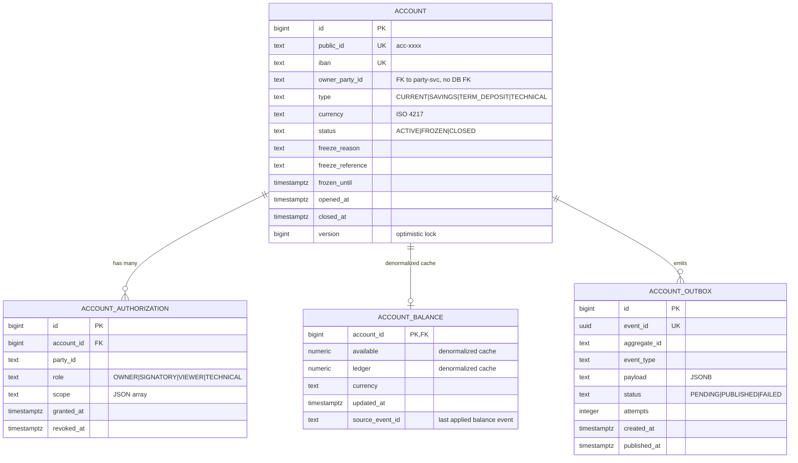

# Data

## Schema

Vlastní PostgreSQL schema `account` v databázi `openbank` (sdílená cluster, schema-per-service izolace).

## Migrace

Flyway, neměnné historické skripty, forward-only:

| Skript | Co dělá |
|---|---|
| `V1__init_accounts.sql` | Schema `account`, tabulka `account`, sekvence pro public_id |
| `V2__add_authorizations.sql` | Tabulka `account_authorization` + indexy |
| `V4__compliance_fields.sql` | Sloupce `freeze_reason`, `freeze_reference`, `frozen_until` |
| `V5__technical_accounts.sql` | Rozšíření `type` o `TECHNICAL`, partial index |
| `V6__create_account_outbox.sql` | Tabulka `account_outbox` (transakční outbox pattern) |

> Pozn.: V3 byla mergnuta do V4 (chybný design rejected v review).

## Indexy

- `account(iban)` — UNIQUE, použit při validaci platebních příkazů
- `account(owner_party_id)` — non-unique, list-by-party query
- `account(status) WHERE status != 'CLOSED'` — partial, ~80% rows
- `account_outbox(status, created_at) WHERE status = 'PENDING'` — dispatcher poll

## Retence

| Tabulka | Retence | Důvod |
|---|---|---|
| `account` | trvale | bankovní zákon, AML, audit |
| `account_authorization` | trvale (logical delete přes `revoked_at`) | audit, dispute resolution |
| `account_balance` | trvale (cache, ne primary) | rebuild z balance-service kdykoliv |
| `account_outbox` | 30 dní po PUBLISHED | troubleshooting, replay |

Cleanup outboxu: scheduled job v `AccountOutboxDispatcher.purgePublished()` — denně 03:00 UTC.

## PII fields (GDPR)

| Field | Klasifikace | Maskování v lozích |
|---|---|---|
| `iban` | PII (přímý identifikátor) | `CZ65…5399` (`PiiMask.maskIban`) |
| `owner_party_id` | pseudonymized id | nezobrazujeme v plaintextu |
| ostatní | non-PII | — |

GDPR **právo na výmaz** se NEAPLIKUJE na `account` — nadřazené pravidlo je AMLD (10 let). Klient může požádat o uzavření účtu; data zůstanou, ale `closed_at` se nastaví a viditelnost se omezí.

## Konzistence vs. balance-service

`account_balance` v této službě je **denormalizovaný cache** pro rychlé UI. Autoritativní zdroj zůstatku je `openbank-balance-service`. Synchronizace:

- balance-service publikuje `balance.updated.v1` event po každé akceptované transakci
- account-service to konzumuje a aktualizuje `account_balance.available/ledger`
- pokud sync zaostane > 5s → admin UI zobrazí "balance may be stale" badge

V případě divergence je **balance-service pravda** — `account_balance` se může rebuildnout přehráním eventů.

## Velikost (odhad pro 1M aktivních klientů)

- `account` ~1.5M rows × ~1 KB = **~1.5 GB**
- `account_authorization` ~3M rows × ~300 B = **~900 MB**
- `account_balance` ~1.5M × ~200 B = **~300 MB**
- `account_outbox` (30-day window) ~50M × ~2 KB = **~100 GB** (největší, plánujeme partitioning po měsíci)

## Retence outboxu (řádky SENT)

`account_outbox` je doručovací buffer, ne záznam. Řádky, které už dorazily do brokeru (`status = 'SENT'`), se mažou, jakmile je jejich `sent_at` starší než `openbank.outbox.retention.sent-days` (výchozí **7**), sdíleným jobem `OutboxSentRetentionJob` z libs-runtime (ADR-0329, ADR-0327 D8). Repozitář se zapojuje delegací `SentOutboxRetention` na `PanacheOutboxRetention`.

- Běží každou noc (`openbank.outbox.retention.cron`, výchozí `0 17 3 * * ?`) na každé replice; každé mazání je omezené (`batch-size` 5 000, nejvýš `max-batches` 200 za běh), takže dlouho nečištěná tabulka se vyprázdní během několika nocí.
- Řádků PENDING, FAILED, DISPATCHING a DEAD se nikdy nedotkne — DEAD řádky jsou DLQ na straně producenta.
- Replay události starší než okno jde z Kafka topicu nebo z audit-service, ne z této tabulky.
- Signály: `openbank_outbox_purged_total{service,status="SENT"}`, `openbank_outbox_purge_failed_total` a workflow liveness `outbox-sent-retention`.
- Vypnutí: `openbank.outbox.retention.enabled=false` (při startu zaloguje WARN). Nesnižujte `sent-days` pod potřebu kteréhokoli čtenáře SENT řádků.

## Pin revize produktu (V33, ADR-0341 D1)

Každý účet otevřený od V33 si na řádku `accounts` zaznamenává PUBLIKOVANOU revizi z produktového
katalogu, pod kterou byl otevřen:

| Sloupec | Význam |
|---|---|
| `product_revision_id`, `product_revision_number` | Revize katalogu a její číslo |
| `product_offering_id` | Nabídka (offering), ke které revize patří |
| `product_revision_product_code` | Kód v1 produktu, proti kterému byl účet otevřen |
| `product_revision_content_hash` | `contentHash` revize, pokud jej katalog vyplnil |
| `product_revision_ir_hash`, `product_revision_ir_version` | Podepsaný `revisionHash` produktového IR a `irVersion` (ADR-0352 §4); u revize bez IR oba null |
| `product_revision_pinned_at` | Okamžik otevření (rovná se `opened_at`, z injektovaných hodin) |

- **Celý, nebo žádný** (`chk_accounts_product_revision_pin_whole`) a **po nastavení neměnný**: trigger
  `trg_accounts_product_revision_pin_immutable` odmítne každý UPDATE, který pin změní nebo smaže. Změna
  podmínek je nová revize a explicitní re-pin, nikdy editace.
- Pin nese událost `AccountCreated` (`productRevision`, aditivně) i REST čtení účtu, takže billing a
  interest jej mohou číst místo vlastního dohledávání.
- `AccountCreated` se zapisuje do `account_outbox` v transakci otevření (dříve přímé odeslání do Kafky
  po commitu).

### Účty otevřené před V33 — plán backfillu (NEPROVEDEN)

Účty existující před V33 pin nemají a **nebyly** potichu doplněny. Jejich počet ukazuje gauge
`openbank.account.product_revision.unpinned` (neuzavřené účty bez pinu; `-1` do prvního změření).
Backfill je samostatná, revidovaná změna:

1. Pro každý účet bez pinu se katalogu zeptat na revizi jeho `product_id` **platnou v jeho `opened_at`**
   — `GET /api/v2/legacy-products/{productId}/published-revision?effectiveAt=<opened_at>` — nikdy na
   revizi publikovanou v okamžiku backfillu, aby zavedení nepřecenilo živou smlouvu (ADR-0341 D1).
2. Účty, jejichž produkt neměl k `opened_at` publikovanou revizi, se NEpinují na pozdější. Předají se
   vlastníkům produktu, kteří pod maker-checkerem vytvoří grandfathering revizi (ADR-0341, Důsledky),
   a pinují se na ni.
3. Zápis nastavuje sloupce pinu jen tam, kde `product_revision_id IS NULL` (trigger nastavení chybějícího
   pinu dovolí, změnu odmítne), po dávkách, idempotentně, s `product_revision_pinned_at` = okamžik běhu
   backfillu a s auditní událostí na účet, která odliší backfillovaný pin od pinu z otevření.
4. Hotovo, když gauge ukazuje `0` a každý zbývající účet bez pinu je pokryt bodem 2.
