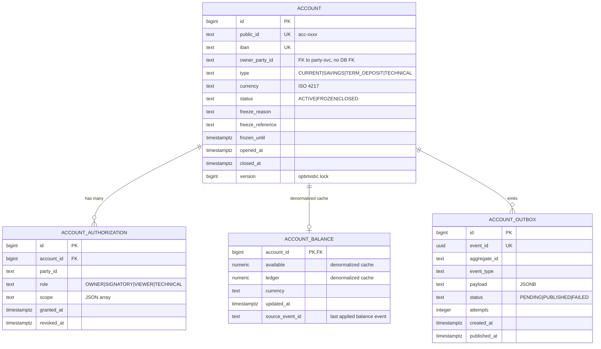

# Data

## Schema

Dedicated PostgreSQL schema `account` in the `openbank` database (shared cluster, schema-per-service isolation).

## Migrations

Flyway, immutable historical scripts, forward-only:

| Script | What it does |
|---|---|
| `V1__init_accounts.sql` | Schema `account`, table `account`, sequence for public_id |
| `V2__add_authorizations.sql` | Table `account_authorization` + indexes |
| `V4__compliance_fields.sql` | Columns `freeze_reason`, `freeze_reference`, `frozen_until` |
| `V5__technical_accounts.sql` | Extends `type` with `TECHNICAL`, partial index |
| `V6__create_account_outbox.sql` | Table `account_outbox` (transactional outbox pattern) |

> Note: V3 was merged into V4 (faulty design rejected in review).

## Indexes

- `account(iban)` — UNIQUE, used to validate payment instructions
- `account(owner_party_id)` — non-unique, list-by-party query
- `account(status) WHERE status != 'CLOSED'` — partial, ~80% of rows
- `account_outbox(status, created_at) WHERE status = 'PENDING'` — dispatcher poll

## Retention

| Table | Retention | Reason |
|---|---|---|
| `account` | forever | banking law, AML, audit |
| `account_authorization` | forever (logical delete via `revoked_at`) | audit, dispute resolution |
| `account_balance` | forever (cache, not primary) | can be rebuilt from balance-service at any time |
| `account_outbox` | 30 days after PUBLISHED | troubleshooting, replay |

Outbox cleanup: scheduled job in `AccountOutboxDispatcher.purgePublished()` — daily 03:00 UTC.

## PII fields (GDPR)

| Field | Classification | Log masking |
|---|---|---|
| `iban` | PII (direct identifier) | `CZ65…5399` (`PiiMask.maskIban`) |
| `owner_party_id` | pseudonymized id | not displayed in plaintext |
| others | non-PII | — |

GDPR **right to erasure** does NOT apply to `account` — AMLD overrides it (10 years). The customer can request account closure; the data remains but `closed_at` is set and visibility is restricted.

## Consistency vs. balance-service

`account_balance` in this service is a **denormalized cache** for fast UI rendering. The authoritative source of balance is `openbank-balance-service`. Synchronisation:

- balance-service publishes a `balance.updated.v1` event after every accepted transaction
- account-service consumes it and updates `account_balance.available/ledger`
- if sync lags > 5 s → admin UI shows a "balance may be stale" badge

In case of divergence, **balance-service is the truth** — `account_balance` can be rebuilt by replaying events.

## Size (estimate for 1M active customers)

- `account` ~1.5M rows × ~1 KB = **~1.5 GB**
- `account_authorization` ~3M rows × ~300 B = **~900 MB**
- `account_balance` ~1.5M × ~200 B = **~300 MB**
- `account_outbox` (30-day window) ~50M × ~2 KB = **~100 GB** (largest, monthly partitioning planned)

## Outbox retention (SENT rows)

`account_outbox` is a delivery buffer, not a record. Rows that reached the broker (`status = 'SENT'`) are deleted once their `sent_at` is older than `openbank.outbox.retention.sent-days` (default **7**), by libs-runtime's shared `OutboxSentRetentionJob` (ADR-0329, ADR-0327 D8). The repository opts in by delegating `SentOutboxRetention` to `PanacheOutboxRetention`.

- Runs nightly (`openbank.outbox.retention.cron`, default `0 17 3 * * ?`) on every replica; each delete is bounded (`batch-size` 5 000, at most `max-batches` 200 per run), so a long-unpurged table drains over several nights.
- PENDING, FAILED, DISPATCHING and DEAD rows are never touched — DEAD rows are the producer-side DLQ.
- Replaying an event older than the window comes from the Kafka topic or audit-service, not from this table.
- Signals: `openbank_outbox_purged_total{service,status="SENT"}`, `openbank_outbox_purge_failed_total`, and workflow liveness `outbox-sent-retention`.
- Opt-out: `openbank.outbox.retention.enabled=false` (logs a WARN at boot). Don't lower `sent-days` below what any reader of SENT rows needs.

## Product-revision pin (V33, ADR-0341 D1)

Every account opened since V33 records the PUBLISHED product-catalog revision it was opened under, on
the `accounts` row itself:

| Column | Meaning |
|---|---|
| `product_revision_id`, `product_revision_number` | The catalog revision and its number |
| `product_offering_id` | The catalog offering the revision belongs to |
| `product_revision_product_code` | The v1 product code the account was opened against |
| `product_revision_content_hash` | Catalog `contentHash` of the revision, when stamped |
| `product_revision_ir_hash`, `product_revision_ir_version` | Signed product-IR `revisionHash` and `irVersion` (ADR-0352 §4); both null for a revision without IR |
| `product_revision_pinned_at` | The opening instant (equals `opened_at`, from the injected clock) |

- **Whole or absent** (`chk_accounts_product_revision_pin_whole`), and **immutable once set**: the
  `trg_accounts_product_revision_pin_immutable` trigger refuses any UPDATE that changes or clears a pin.
  A change of terms is a new revision plus an explicit re-pin event, never an edit.
- The pin travels on the `AccountCreated` event (`productRevision`, additive) and on the REST account
  read, so billing and interest can read it instead of resolving their own.
- `AccountCreated` is written to `account_outbox` in the opening transaction (it used to be a direct
  Kafka send after commit).

### Accounts opened before V33 — backfill plan (NOT executed)

Accounts that existed before V33 have no pin and were **not** silently backfilled. Their number is the
`openbank.account.product_revision.unpinned` gauge (accounts not CLOSED with no pin; `-1` until the
first count). The backfill is a separate, reviewed change:

1. For each unpinned account, ask product-catalog for the revision of its `product_id` **effective at
   its `opened_at`** — `GET /api/v2/legacy-products/{productId}/published-revision?effectiveAt=<opened_at>`
   — never the revision published when the backfill runs, so adoption does not reprice a live
   contract (ADR-0341 D1).
2. Accounts whose product had no revision published at `opened_at` are NOT pinned to a later one. They
   are listed for product owners, who create a grandfathering revision under maker-checker (ADR-0341,
   Consequences) and pin to that.
3. The write sets the pin columns only where `product_revision_id IS NULL` (the trigger allows setting
   an absent pin and refuses changing one), in batches, idempotent on re-run, with
   `product_revision_pinned_at` = the backfill run instant and an audit event per account
   distinguishing a backfilled pin from an opening pin.
4. Done when the gauge reads `0` and every remaining unpinned account is accounted for by step 2.
