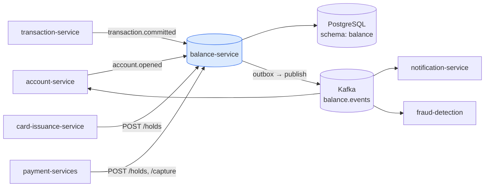
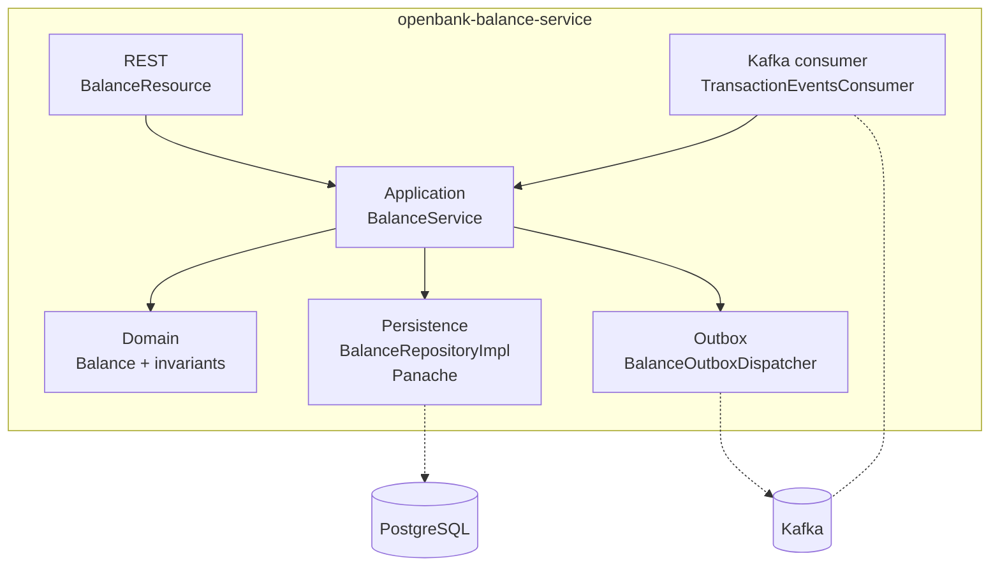
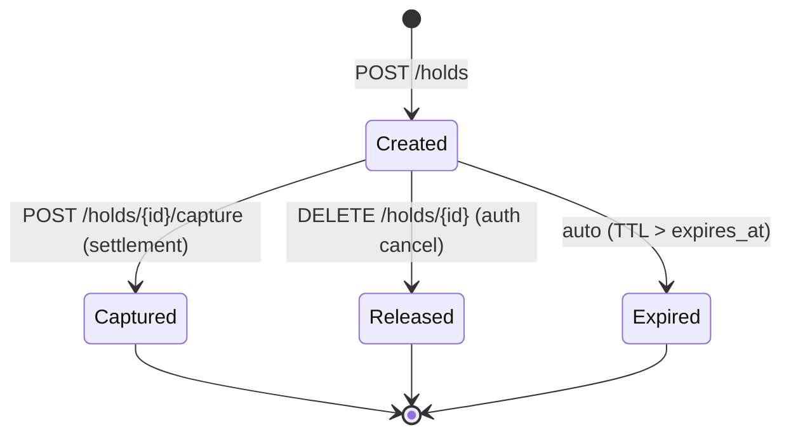

# Architecture

## C4 — System Context



## C4 — Container



## Layers

```
com.openbank.balance/
├── domain/
│   └── model/Balance.kt              ← invariants (arrangedOverdraft ≥ 0, version monotonic)
├── application/
│   ├── port/in/BalancePort.kt
│   ├── port/out/BalancePorts.kt + BalanceOutboxPort.kt
│   └── usecase/BalanceService.kt
└── infrastructure/
    ├── rest/                          BalanceResource, ExceptionMappers
    ├── persistence/repository/        BalanceRepositoryImpl (Panache)
    ├── persistence/entity/            BalanceEntity, BalanceOutboxEntity
    ├── outbox/                        BalanceOutboxDispatcher (@Scheduled)
    └── kafka/                         Producer + outbox publisher
```

## Core invariants

1. **`(account_id, currency)` UNIQUE** — one balance per account × currency
2. **Optimistic lock** — `version` increments atomically; concurrent debits from different authorisations cannot double-spend
3. **`arrangedOverdraftLimit ≥ 0`** — enforced in the `Balance.init {}` block
4. **The available formula has no conditions**: `available = booked − reserved − pendingDebit + arranged_overdraft`. No alternate calculation is allowed anywhere else.
5. **Outbox-first**: every balance change → DB UPDATE + outbox INSERT in a single TX

## Hold lifecycle



On `Captured` reserved decreases and pending increases. The real transaction event later updates booked.

## Components from openbank-libs

| Module | Use |
|---|---|
| `libs.domain.money.Money` + `CurrencyCode` | typesafe balances |
| `libs.domain.identifiers.AccountId` | typesafe ID |
| `libs.persistence.outbox` | abstract outbox entity + dispatcher loop |
| `libs.web.ServiceInfoResource` | `/api/v1/info` |
| `libs.docs.DocsResource` | **this documentation** (`/q/openbank/docs`) |
| `libs.util.BuildInfo` | tech-stack snapshot |

### Immutable branch projection and bank control (ADR-0380 B2)

AccountCreated records the shared bank/establishment/host/mode context once in `account_booking_context`.
A movement cannot create or change that context. Branch journal events wait for an out-of-order account event;
a different branch, changed duplicate or conflicting AccountCreated is dead-lettered before money or cover moves.
Transient database failure retries the original unacknowledged Kafka record. Dedup, booked movement, cover and
the outbox commit together, including the journal book. Do not acknowledge a failed projection manually.

`POST /api/v1/balances/reconciliation/branch-books?bankId=...&asOf=...` compares native-currency deposit-control
amounts for each book and for the bank. The materialized balances are rewound by their future value-dated tail.
Journal debit/credit checks use base currency. Two opposite branch differences remain visible even if the bank
matches; the drift gauge records the largest absolute branch difference per currency. Synthetic account contexts
are excluded, matching the Ledger BUSINESS scope. Unknown historic attribution remains explicit and prevents
`complete=true`; do not backfill it from a payment or an IBAN. The existing bank-only control is retained.

With the ledger projection enabled, the real scheduler refreshes evidence every 60 seconds and retries after
an outage/restart without an operator POST. Failed captures never overwrite the last report; inspect generatedAt
and workflow liveness for freshness. This is an eventually consistent control across two source databases.
Deploy the Ledger reader and schemas before the account writer/projection cutover. Rollback stops the new
writers/consumers first and retains contexts, dated markers and reconciliation evidence.
