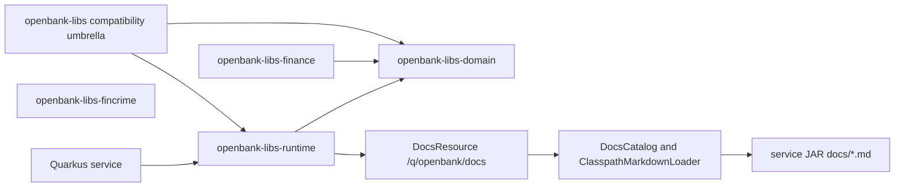

# 02 — Architecture

## Current module boundary

`openbank-libs-domain` contains shared domain primitives and ports. Its build file documents the framework boundary; it must not import Quarkus or CDI. `openbank-libs-runtime` contains framework adapters, HTTP resources and CDI wiring. It exports domain types to consumers. The root `openbank-libs` module remains a compatibility umbrella for existing dependencies; it no longer owns the library source.

`openbank-libs-finance` uses the domain kernel's `BusinessCalendar` and `BusinessDayConvention` for financial schedules. It has no enum of its own for this; schedule rules take the kernel enum directly. `UNADJUSTED` leaves a date unchanged even on a holiday; the four existing roll conventions retain their order and behavior. Calendar closures and any extra holidays affect schedule fingerprints, so changing them can change a schedule's version.

The service owns its documentation files at `src/main/resources/docs/`. The common Gradle convention generates `00-build.md` during `processResources` and packages it beside authored Markdown. `ClasspathMarkdownLoader` reads those classpath resources, `DocsCatalog` selects language variants and hashes content, and `DocsResource` publishes the index, metadata and documents from the running build. The Admin UI fetches the running endpoint through Kubernetes discovery. This keeps the displayed service documentation tied to the deployed image.

`openbank-libs` itself has no running endpoint. Its top-level `docs/` tree is bundled with the Admin UI image as a snapshot. Refer to the source modules and the service's own `/q/openbank/docs` for current runtime behavior.

## Build and compatibility

The root build uses Gradle subprojects. Service modules generally declare `implementation(project(":openbank-libs-runtime"))`, while older consumers can use the umbrella. The authoritative dependency versions are in `openbank-libs/gradle/libs.versions.toml`; Gradle conventions are in `build-logic/src/main/kotlin/`. Each service's release version is its own `version.txt`.

Shared libraries and services use Quarkus **3.40.1.1 LTS** from the same catalog. Framework dependencies in runtime, testing and Temporal adapters retain their existing dependency scopes; the domain kernel remains framework-free. Shared Micrometer APIs use the platform's **1.17.1** version. Security overrides must preserve or exceed the platform's patched versions. See the [upgrade and rollback runbook](../../docs/runbooks/quarkus-lts-upgrade.md) for compatibility checks and promotion criteria.

## Four-eyes: approval summaries

`AuthorizeInterceptor` (`openbank-libs-runtime`, ADR-0155) parks an operation OPA flags `four_eyes_required`, answers 202 with an `approvalId`, and binds the approval to a fingerprint of the exact request (endpoint + arguments, #11675). It also stores a human-readable `summary` for the checker.

- **Default:** a service without a renderer gets the generic summary — action, endpoint, resource and the arguments with credential-like fields (`password`, `token`, `pin`, …) redacted, control characters flattened, capped at 1024 characters.
- **`ApprovalSummaryRenderer` (optional):** a service may supply a CDI bean with `suspend fun render(action, resourceId, arguments): String?`. The interceptor passes it the same business arguments the request fingerprint covers, and its output (flattened and capped the same way) replaces the generic summary. It runs whenever a request is bound (a retry with `X-Approval-Id` included) but is stored only when the approval is created, so the checker reads the summary of what was bound, never a re-derived one. Returning `null` keeps the generic summary for actions the renderer does not cover.
- **Failure:** a renderer exception refuses the call (503, `PolicyDecisionException`): no approval is issued with a missing summary or with the generic argument dump the renderer exists to replace.
- **Informational only:** the fingerprint alone decides whether a retry matches, never the summary text.
- **PII:** operators read the summary, so include only what the checker needs to recognise the target. Mask accounts and IBANs (e.g. last 4 characters), never print key material (a short SHA-256 prefix is enough), no secrets, and shape-check caller-supplied values rather than echoing them. Worked example: `ScaApprovalSummaryRenderer` in sca-service.

## Policy-rate topic ownership

`openbank-libs-domain` maps `openbank.fx.cnb-policy-rate.published` to `fx-service` in `TopicProducers`. This records the producing service for shared analytics and governance checks; it does not publish or consume the event. The producer is the FX ingestion pipeline, while risk-engine and audit-service consume its facts and audit trail. Keep the mapping in step with a topic rename or ownership change.

`TopicProducers` maps the shared `openbank.oversight-triggers` topic to `multiple-producers`, because both aml-service and sanctions-service publish independent oversight requests to it. Audit-service subscribes to the same topic so those requests become part of the audit trail. The shared mapping attributes ownership; it neither publishes nor consumes events.

## Build-time producers

`RedisApprovalStoreProducer` (four-eyes `ApprovalStore`, opt-in `openbank.approval.store: redis`) and `OpaPolicyDecisionPointProducer` (OPA sidecar PDP, opt-in `openbank.authz.opa-pdp-producer.enabled: true`) are gated with `@IfBuildProperty`, off when the property is missing. Neither is `@DefaultBean`: a service that opts in and also keeps its own producer fails `quarkusBuild` as an ambiguous dependency. Bean presence matters because `AuthorizeInterceptor` switches four-eyes on when an `ApprovalStore` exists.

## Outbox trace context

`PanacheOutboxEntityTraced` (libs-runtime) extends the v2 outbox entity with a nullable `trace_context` column holding the W3C `traceparent` captured by `TraceparentCapture` when the row is written. `OutboxEntry.traceparent` carries it to the dispatcher and `OutboxKafkaHeaders` emits it as the `traceparent` Kafka header. It is opt-in per service together with an `ALTER TABLE ... ADD COLUMN trace_context TEXT` migration; the v1 and v2 bases are unchanged because a mapped column a table lacks fails every SELECT.

## Bank-own transfer rail vocabulary (ADR-0344 phase 1b)

`openbank-libs-iso20022` holds the vocabulary of the bank-own institution-transfer rail, so swift-service and treasury name it the same way:
- `InstitutionTransferRail` is CERTIS, TARGET2 or SWIFT, each with its currency and pacs.009 clearing system code.
- `InstitutionTransferStatus` is the rail's lifecycle. Only ACCEPTED, SENT, SETTLED and REJECTED are published (contract 9.2).
- The pacs.009 builder and reader validate against the bundled `pacs.009.001.08` XSD.

The shared `TopicProducers` table in `openbank-libs-domain` attributes `openbank.swift.institution-transfers` to swift-service, which is how audit-service labels the rows it reads from that topic.

The same table attributes `openbank.tpp.registry.event` to tpp-registry-service, so audit-service can label the TPP register changes (registered, blacklisted) it records on the audit trail.

### Temporal worker pilot

The version catalog exposes Temporal SDK/testing 1.40.0 for transaction-service's
versioned worker pilot (ADR-0355). `openbank-libs-temporal` retains its compile-only
1.25.1 contract, and other services retain their existing SDK version. This is not
a fleet-wide runtime upgrade. Original histories gate forward replay; new histories
must not be assumed readable by the old SDK.
