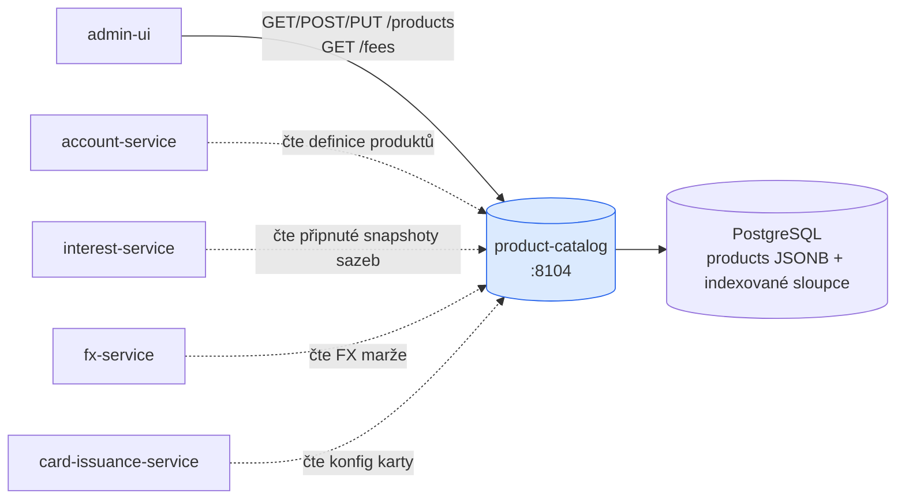
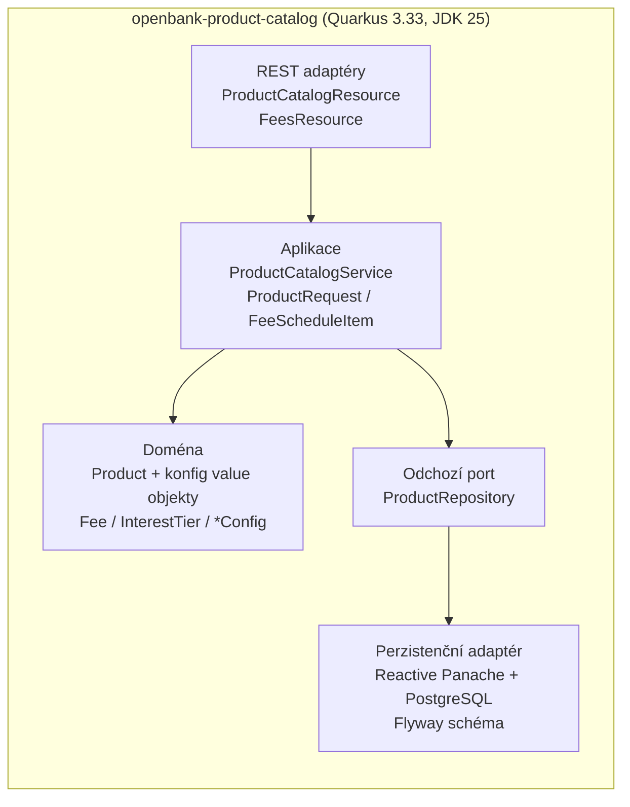

# Architektura

## C4 — Kontext systému



Katalog je **poskytovatel referenčních dat**. Nemá downstream volání ani účast na peněžní cestě. Publikační důkazy ukládá do trvalého outboxu, ale zatím nemá brokerový transportní adaptér. Úrokové zpracování musí číst připnutý snapshot s dobou účinnosti, ne aktuální katalogovou hodnotu během peněžního výpočtu.

## C4 — Kontejner (vnitřní struktura)



## Hexagonální vrstvy (ADR-0002)

Struktura balíčků odráží **ports-and-adapters**:

```
com.openbank.productcatalog/
├── domain/                      ◄── jádro — bez framework závislostí
│   └── Product.kt               Agregát Product + value objekty:
│                                  Fee, InterestTier, CardConfig,
│                                  MultiCurrencyConfig, OverdraftConfig,
│                                  TermDepositConfig, SavingsConfig,
│                                  TermsAndConditions, ProductVersion
│                                  + enumy (ProductType, ProductStatus, …)
│
├── application/                 ◄── orchestrace use-casů
│   └── ProductCatalogService.kt ProductCatalogService (CRUD + seed +
│                                  zploštění sazebníku),
│                                  ProductRequest (DTO ↔ doména),
│                                  FeeScheduleItem (zploštělý řádek poplatku)
│
└── infrastructure/
    ├── persistence/             ◄── odchozí adaptér (Reactive Panache/PostgreSQL)
    └── rest/                    ◄── vstupní adaptéry (JAX-RS)
        ├── ProductCatalogResource   /api/v1/products
        └── FeesResource             /api/v1/fees
```

`ProductRepository` je odchozí perzistenční port. Registrace reflexe pro native image žije v infrastruktuře, takže doména nemá frameworkové importy (ADR-0002).

## Doménový model

Kořen agregátu je **`Product`** (identita `id`/`code`, `name`, `type`, `currency`, životní cyklus `status`, ceny `baseRate`/`fee`/`fees[]`). Volitelné konfigurační bloky podle typu připojují bohaté chování:

| Blok | Používá | Nese |
|---|---|---|
| `cardConfig` | CURRENT / CREDIT_CARD | sítě, úrovně, min/max karet, virtuální/bezkontaktní, měsíční poplatek |
| `multiCurrencyConfig` | multi-měnové produkty | podporované měny, výchozí měna, FX nákupní/prodejní marže |
| `overdraftConfig` | CURRENT / OVERDRAFT | povolené/nepovolené limity, sazby, odklad, denní poplatek |
| `termDepositConfig` | TERM_DEPOSIT | délka v měsících, frekvence výplaty, sankce za předčasný výběr |
| `savingsConfig` | SAVINGS | úroková pásma, výpovědní lhůta, počet výběrů zdarma, bonusová sazba |

`versionHistory[]` jsou legacy informativní data, nikoli neměnný auditní důkaz. `termsAndConditions[]` nese reference s dobou účinnosti. Autoritativní neměnné revize zavádí v2 dle ADR-0257.

## Banking deposit pack v2

`org.openbank.banking.deposit:2` je deklarativní profil vkladového produktu. Vyžaduje měnu, typ produktu a objekt `interest` s explicitní konvencí počtu dní a frekvencí výplaty. Sazba je buď kanonický desetinný řetězec pro pevnou roční sazbu, nebo neprázdný seznam pásem. Bankovní slovník tak zůstává mimo průmyslově neutrální jádro a přesný profil je součástí neměnné publikované revize.

Nejde záměrně o živé cenové čtení. Budoucí adaptér interest-service musí z publikovaného profilu vytvořit snapshot sazby s dobou účinnosti ještě před výpočtem úroku; čtení nejnovějšího katalogového dokumentu při úročení by zničilo reprodukovatelnost historie.

## Zploštění sazebníku

`ProductCatalogService.listFeeSchedule()` zploští `fees[]` všech produktů do jednoho celobankovního sazebníku. Každý `FeeScheduleItem` nese:

- stabilní složené id `"<productId>:<feeId>"`,
- odvozený zobrazovací kód `"<PRODUCT_CODE>_<FEE_SLUG>"` (např. `CURRENT_PERSONAL_FX_CONVERSION`), který se mění s metadaty poplatku,
- identitu vlastnícího produktu (`productId`, `productCode`, `productName`) a jeho `status`, plus `updatedAt`.

Toto poskytuje `GET /api/v1/fees`, takže admin UI vykreslí ceny bez opětovného načítání každého produktu a nikdy nezadrátuje ceník napevno.

## Události / outbox

Každá přijatá v2 změna perzistuje doménový stav, auditní záznam a verzovanou obálku `CatalogChangeEvent` ve stejné PostgreSQL transakci. Publikace navíc zapisuje schválení maker-checker. Publikované revize, audit a outbox jsou na úrovni databáze neměnné. Dispatcher do Kafky není součástí tohoto řezu; outbox zůstává transportně neutrální.

## Manifesty packů a schvalovací politika revizí (ADR-0345)

Každý pack obsahuje soubor `catalog-packs/<pack>/pack.json`. Manifest uvádí schémata packu v pořadí
registrace a u každé verze schématu může mít volitelnou `approvalPolicy`. Politika má tři části:

- kódy rolí, z nichž každý je navázaný na interní autoritu;
- volitelné `requireEffectiveFrom`;
- povinné hodnoty atributů nejvyšší úrovně.

Seeder si zapnuté packy najde podle jejich manifestů, takže kernel nejmenuje žádný pack, schéma, roli
ani autoritu. Zaregistrovaná politika je pro danou verzi schématu jen append-only.

Revize schématu s politikou se publikuje až tehdy, když přesný digest obsahu schválí každá deklarovaná
role. Každou roli musí schválit jiný principal, a nikdy maker. Schválení probíhá přes
`/api/v2/offerings/{o}/revisions/{r}/approvals/{role}`. `/pension-approvals` je zastaralý alias.

Konfigurace nasazení váže každou autoritu na scope a realm roli, které musí nést tentýž token:
`openbank.catalog.approval.authorities.<AUTHORITY>`.

Gate `catalog-kernel-industry-neutral` drží oborový slovník mimo kernel. Zároveň hlídá zmrazené
hodnoty enumů `/api/v1`.
