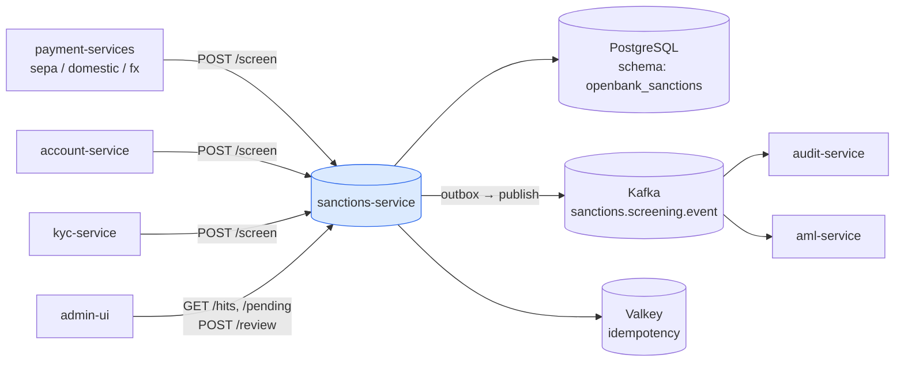
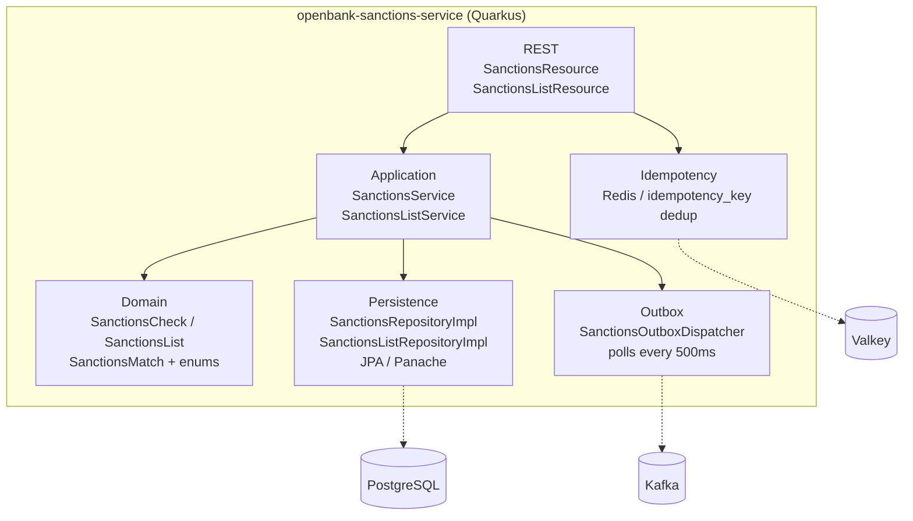
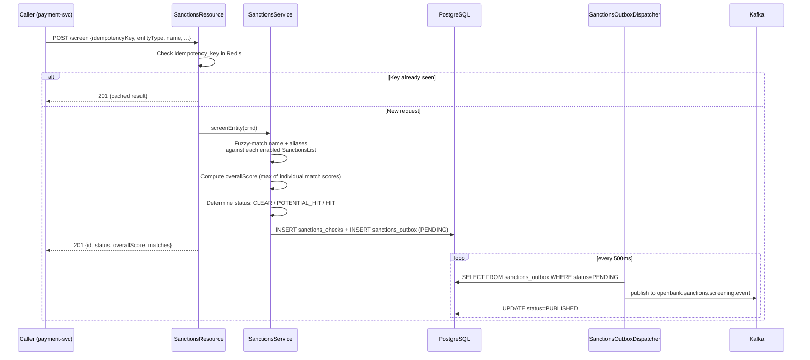

# Architecture

## C4 — System Context



## C4 — Container (internal structure)



## Hexagonal layers

```
com.openbank.sanctions/
├── domain/                        ◄── core — no framework dependencies
│   └── model/                     SanctionsCheck, SanctionsList, SanctionsMatch
│                                  SanctionsCheckStatus, SanctionsListType, MatchType, EntityType
│
├── application/                   ◄── use-case orchestration
│   ├── port/in/                   SanctionsPorts (inbound commands)
│   ├── port/out/                  SanctionsOutboxPort + SanctionsPorts (outbound)
│   └── usecase/                   SanctionsService, SanctionsListService
│
└── infrastructure/                ◄── adapters
    ├── rest/                      SanctionsResource, SanctionsListResource (JAX-RS)
    ├── persistence/
    │   ├── entity/                SanctionsCheckEntity, SanctionsListEntity, SanctionsOutboxEntity
    │   ├── mapper/                SanctionsMapper (entity ↔ domain)
    │   └── repository/            SanctionsRepositoryImpl, SanctionsListRepositoryImpl,
    │                              SanctionsOutboxRepositoryImpl
    ├── outbox/                    SanctionsOutboxDispatcher (scheduled)
    └── kafka/                     KafkaSanctionsOutboxEventPublisher
```

**Dependency rule:** `domain` ← `application` ← `infrastructure`. Domain code never sees JPA, Kafka, or REST DTOs.

## Screening algorithm

When `POST /api/v1/sanctions/screen` is called, `SanctionsService` runs the following pipeline:



### Match scoring

| Match type | Score range | Trigger |
|---|---|---|
| `EXACT` | 1.0 | Name or alias is identical (case-insensitive, diacritics-normalised) |
| `FUZZY` | 0.7–0.99 | Levenshtein distance ≤ 2 on names with ≥ 5 chars |
| `PHONETIC` | 0.6–0.89 | Soundex / double-metaphone match |
| `ALIAS` | 0.5–0.95 | Known alias in the list entry matches |

`overallScore` = max of all individual match scores across all lists.

Status assignment:
- `overallScore == 1.0` → `HIT`
- `overallScore > 0.85` → `POTENTIAL_HIT`
- `overallScore ≤ 0.85` → `CLEAR`
- After human review: `WHITELISTED` or `ESCALATED`

Domain method `SanctionsCheck.isHighRisk()` returns `true` for `HIT` or `POTENTIAL_HIT` with score > 0.85.

## Outbox flow

**Why outbox:** transactional consistency between the DB write and Kafka publish. At-least-once delivery, idempotent consumers.

```
SanctionsService writes to sanctions_checks AND sanctions_outbox in one TX
    ↓ (within 500ms)
SanctionsOutboxDispatcher polls PENDING rows
    ↓
KafkaSanctionsOutboxEventPublisher sends to openbank.sanctions.screening.event
    ↓
audit-service + aml-service consume the event
```

A `SanctionChecked` event that meets `SanctionsCheck.isHighRisk()` also fans out from the same durable outbox row to `openbank.oversight-triggers` (ADR-0031 D9). The trigger body contains only `sourceService` and `occurredAt`, with the original `ce-id`/`ce-type` headers for correlation. Screened names, identifiers, match details and list data are not copied to the oversight topic. CLEAR results, lower-scoring potential hits, reviews and list-change events stay on the domain topic only.

## Components from `openbank-libs`

| Module | Use here |
|---|---|
| `libs.idempotency.IdempotencyStore` | Redis-backed deduplication by `idempotencyKey` |
| `libs.persistence.outbox` | OutboxEntity base, OutboxRepository, OutboxDispatcherBase |
| `libs.security.BootstrapVerifier` — ⬜ **not consumed, does not exist** | **Nothing.** This class is not in `openbank-libs` and never was (`git grep BootstrapVerifier -- '*.kt'` returns 0); ADR-0017 prescribes it and its own delivery note records that it was not shipped. Dev passwords are kept out of prod by ESO/OpenBao `secretKeyRef` injection (ADR-0007), not by libs code (#8426) |
| `libs.web.ServiceInfoResource` | `/api/v1/info` (build metadata) |
| `libs.docs.DocsResource` | **this documentation** (`/q/openbank/docs`) |
| `libs.util.BuildInfo` | runtime tech-stack snapshot |

## Principles

1. **Screening is synchronous, publication is async** — the caller gets the result immediately; Kafka notification is via outbox.
2. **Idempotent at edge** — mandatory `idempotencyKey` in request body; same key returns cached result.
3. **Human-in-the-loop for fuzzy matches** — `POTENTIAL_HIT` never auto-blocks; requires compliance review.
4. **No list data stored** — only match metadata; list entries remain at their authoritative source URLs.
5. **PII minimisation** — `name` and `dateOfBirth` are PII; masked in logs.

## Scheduled-job heartbeat

The 60-second sanctions-list refresh tick registers the fleet workflow-liveness heartbeat `sanctions-list-refresh` (`DomainMetrics.registerWorkflowLiveness`, seeded at startup) and records a success only on its success path: a tick counts as a success only when no list failed in it, so a feed that fails every minute goes stale instead of reading healthy. `WorkflowLivenessStale` alerts when the age exceeds twice the expected interval.

## Shared check status and block threshold (ADR-0353)

`SanctionsCheckStatus` is a typealias of `ScreeningMatchStatus` from `openbank-libs-fincrime`, the type the payment rails read off the wire. `isHighRisk` reads the shared `ScreeningPolicy.POTENTIAL_HIT_BLOCK_THRESHOLD` (0.85), the same bound the rails block on. Persisted values (`@Enumerated(STRING)`) and the API spelling are unchanged.

## Ongoing monitoring (ADR-0376)

Off by default (`openbank.sanctions.monitoring.enabled=false`). A screen answers for the moment it runs; ongoing monitoring covers what happens to the lists afterwards.

- **Registry.** A service registers a subject it has onboarded (`sanctions_monitored_subjects`) with the attributes the `CUSTOMER` profile reads, under the same reference it uses as `subjectId` when screening.
- **Delta.** The change journal that already records every committed change of a list entry also feeds `sanctions_monitoring_pending` (a trigger; it writes nothing while the registry is empty). `SanctionsMonitoringService.runDelta` takes a bounded batch of changed entries and matches each against the registry with the live screen's own `word_similarity(subject name, entry search text)` and the `CUSTOMER` floor. It is the reverse of a screen: one entry, every subject.
- **Sweep.** `runSweep` re-evaluates a bounded batch of whole subjects through `SanctionsService.uncoveredMatches`, the function `screen` itself is built on. Never-swept subjects go first, then the least recently swept; every subject is due again after `sweep.interval` (default 30 days). It is the safety net for a missed delta and the only path that sees jurisdiction reference data.
- **Fallback.** A backlog above `delta.max-pending`, or an entry matching more than `delta.max-candidates-per-entry` subjects, is not matched entry by entry: the queue is dropped and every subject becomes due for a sweep, in one transaction.
- **Findings.** One row per subject, list entry and version of the entry's names, written with its `MONITORED_SUBJECT_MATCHED` outbox event in one transaction. The version ignores the order of names, so a feed that reorders aliases raises nothing. A clearance is honoured by the rule the live screen uses; PEP and jurisdiction matches are never covered by one.

Both scheduled methods are `suspend` functions and register the workflow-liveness heartbeats `sanctions-monitoring-delta` and `sanctions-monitoring-sweep` only when monitoring is enabled; a disabled job that registered one would raise `WorkflowLivenessStale` in every environment that has not switched the feature on.
