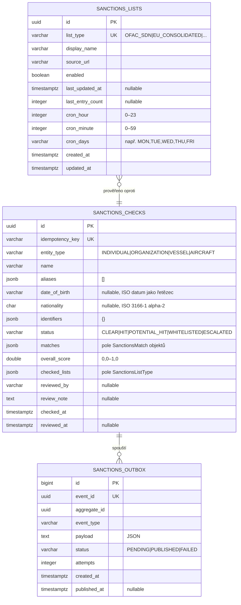

# Data

## Schema

Vlastní PostgreSQL schema `openbank_sanctions` v databázi `openbank` (sdílený cluster, izolace schema-per-service).

## Migrace

Flyway, neměnné historické skripty, pouze dopředu:

| Skript | Co dělá |
|---|---|
| `V1__create_sanctions.sql` | Tabulka `sanctions_checks`, indexy na `status`, `name`, `overall_score` |
| `V2__create_sanctions_outbox.sql` | Tabulka `sanctions_outbox` (transakční outbox pattern) |
| `V3__create_sanctions_lists.sql` | Tabulka `sanctions_lists` s 6 seed záznamy (jeden na typ listiny) |
| `V4__hibernate_sequences.sql` | Hibernate sekvence pro generování surrogate klíčů |

> Migrace jsou po aplikování neměnné. Nikdy neupravujte migraci, která byla aplikována na produkční DB.

## Referenční data jurisdikcí

`sanctions_jurisdictions` (V21) obsahuje země pod embargem a vysoce rizikové země: `list_type`,
`source_list`, `country_code`, `measure` (`EMBARGO` | `HIGH_RISK`), `version`, `source_ref`,
`published_on`, `verified_on`, `active`. `list_type` je listina, pod kterou se řádek při prověření
použije; `source_list` je vydání, ze kterého byl převzat.

Žádný importovaný zdroj je nezveřejňuje jako strojově čitelný feed — import `FATF_HIGH_RISK` se
přeskakuje, protože není založen na entitách — proto jde o **verzovaná referenční data**. Mění se
jen revidovanou Flyway migrací: nové vydání přidá řádky s vyšší `version` a nahrazené řádky vyřadí
(`active = false`), takže historie zůstává v tabulce. Částečný unikátní index dovoluje jeden
aktivní řádek na (listinu, vydání, zemi). Tabulku nezapisuje žádný endpoint: které země jsou
uvedeny, je rozhodnutí compliance zaznamenané v migraci, která je přidá.

| `source_list` | Naplněno | Zdroj |
|---|---|---|
| `EU_HIGH_RISK_THIRD_COUNTRIES` | V22 — 26 zemí, všechny `HIGH_RISK` | Nařízení Komise v přenesené pravomoci (EU) 2016/1675, příloha, konsolidované znění z 29. 1. 2026; porovnáno s EUR-Lex 11. 11. 2026 |
| `FATF_CALL_FOR_ACTION` | nenaplněno | web vydavatele se nepodařilo načíst; žádný řádek se nezapisuje zpaměti |
| `FATF_INCREASED_MONITORING` | nenaplněno | totéž |

Žádný řádek nemá `EMBARGO`: nařízení EU ukládá posílenou due diligence, nikoli zákaz, a žádný
dosud načtený zdroj embargo země neuvádí.

**Stárnutí.** Tyto listiny se mění několikrát ročně a nic je neimportuje, proto každý řádek nese
datum svého vydání (`published_on`) a datum posledního porovnání se zdrojem (`verified_on`).
Ověření, které zjistí, že se zdroj nezměnil, je také migrace — posune `verified_on`. Služba
zveřejňuje stáří obou údajů podle `source_list`; viz `05-operations`.

## Indexy

- `sanctions_checks(idempotency_key)` — UNIQUE, deduplikace při insertu
- `sanctions_checks(status)` — dotazy na hity/čekající
- `sanctions_checks(name)` — částečné textové vyhledávání
- `sanctions_checks(overall_score DESC)` — řazení podle rizikového skóre
- `sanctions_outbox(status, created_at ASC) WHERE status='PENDING'` — poll dispatcheru
- `sanctions_outbox(aggregate_id)` — vyhledávání eventu podle ID prověření

## JSONB sloupce

`aliases`, `identifiers`, `matches` a `checked_lists` jsou uloženy jako JSONB v PostgreSQL pro flexibilitu schématu:

- `aliases` — `["alias1", "alias2"]`
- `identifiers` — `{"passport": "123456", "taxId": "CZ..."}`
- `matches` — pole objektů `SanctionsMatch` (viz doménový model)
- `checked_lists` — `["OFAC_SDN", "EU_CONSOLIDATED", ...]`

Každý z těchto sloupců drží pole nebo objekt, nikdy JSONB string. Starší řádky ukládaly JSON text zabalený jako JSONB string (`"[\"OFAC_SDN\"]"`); čtení přes `::text` pak vrátilo řetězec v uvozovkách, Jackson ho nenačetl a `GET /api/v1/sanctions` odpovídal 400. Migrace V20 tyto hodnoty rozbalí; hlídá to `SanctionsLegacyJsonbStringIT`.

## Retence

| Tabulka | Retence | Důvod |
|---|---|---|
| `sanctions_checks` | 10 let | Zákonný požadavek záznamu AML/CFT; AMLD 6 čl. 40 |
| `sanctions_lists` | navždy | konfigurace, audit změn listin |
| `sanctions_outbox` | 30 dní po PUBLISHED | řešení problémů, přehrávání |

GDPR **právo na výmaz** se na `sanctions_checks` NEVZTAHUJE — přepíše ho AML směrnice (10 let). Jméno a identifikátory jsou součástí zákonem požadovaného AML záznamu.

## PII pole (GDPR)

| Pole | Klasifikace | Maskování v logu |
|---|---|---|
| `name` | PII (přímý identifikátor) | první 3 znaky + maskování `***` |
| `date_of_birth` | PII (přímý identifikátor) | maskováno v logu |
| `nationality` | non-PII (pouze kód země) | — |
| `identifiers` | PII (pas, daňové ID) | maskováno v logu |
| `aliases` | PII (alternativní jména) | maskováno v logu |

Právní základ pro zpracování: **Právní povinnost** (čl. 6 odst. 1 písm. c) GDPR) + povinnost dle AML směrnice.

## Odhady velikosti (1M prověření/rok)

- `sanctions_checks` ~1M řádků/rok × ~2 KB (s JSONB) = **~2 GB/rok** (10letá retence → ~20 GB)
- `sanctions_lists` — 6 řádků, zanedbatelné
- `sanctions_outbox` (30denní okno) ~80k řádků × ~1 KB = **~80 MB** (nízký objem: ne každá platba spouští prověření pokaždé)

## Retence outboxu (řádky SENT)

`sanctions_outbox` je doručovací buffer, ne záznam. Řádky, které už dorazily do brokeru (`status = 'SENT'`), se mažou, jakmile je jejich `sent_at` starší než `openbank.outbox.retention.sent-days` (výchozí **7**), sdíleným jobem `OutboxSentRetentionJob` z libs-runtime (ADR-0329, ADR-0327 D8). Repozitář se zapojuje delegací `SentOutboxRetention` na `PanacheOutboxRetention`.

- Běží každou noc (`openbank.outbox.retention.cron`, výchozí `0 17 3 * * ?`) na každé replice; každé mazání je omezené (`batch-size` 5 000, nejvýš `max-batches` 200 za běh), takže dlouho nečištěná tabulka se vyprázdní během několika nocí.
- Řádků PENDING, FAILED, DISPATCHING a DEAD se nikdy nedotkne — DEAD řádky jsou DLQ na straně producenta.
- Replay události starší než okno jde z Kafka topicu nebo z audit-service, ne z této tabulky.
- Signály: `openbank_outbox_purged_total{service,status="SENT"}`, `openbank_outbox_purge_failed_total` a workflow liveness `outbox-sent-retention`.
- Vypnutí: `openbank.outbox.retention.enabled=false` (při startu zaloguje WARN). Nesnižujte `sent-days` pod potřebu kteréhokoli čtenáře SENT řádků.

## Čtení JSONB payloadů sankčních kontrol

Sloupce `aliases`, `identifiers`, `matches` a `checked_lists` v `sanctions_checks` zůstávají JSONB s původními výchozími hodnotami a omezením NOT NULL. Entita drží JSON jako text v Kotlinu: SQL při čtení převádí sloupce na text a při zápisu převádí vázaný text na JSONB. Mezilehlý textový cast při zápisu brání uložení JSON dokumentu jako citovaného JSON řetězce. Databázová validace JSON zůstává zachovaná; migrace typu těchto sloupců není potřeba.

Mapování umožňuje seznamu, detailu a čekajícím kontrolám číst neprázdná pole i objekty bez změny odpovědí nebo screeningových rozhodnutí. Regresní test se skutečným PostgreSQL pokrývá existující JSONB záznamy, reaktivní vložení a aktualizaci s opětovným načtením změněných payloadů, volitelná metadata, odmítnutí neplatného JSON a404 pro chybějící id. Kladné HTTP testy používají testovací identitu a neprokazují produkční JWT ani vynucení politik.

## Tabulky průběžného monitoringu (V23, ADR-0376)

| Tabulka | Obsah | Retence |
|---|---|---|
| `sanctions_monitored_subjects` | Jeden řádek na registrovaný subjekt: vlastnící služba, reference subjektu, typ entity, jméno, aliasy, normalizovaná jména pro hledání, datum narození, státní příslušnost, země, evidence sweepu | Do odregistrace, která řádek smaže |
| `sanctions_monitoring_findings` | Jeden řádek na subjekt, položku seznamu a verzi jmen položky; `delisted_at`, jakmile položka seznam opustila | Maže se se subjektem (`ON DELETE CASCADE`) |
| `sanctions_monitoring_pending` | Fronta potvrzených změn položek, které ještě nebyly porovnány | Do porovnání, nebo do zahození ve prospěch nového sweepu |
| `sanctions_monitoring_state` | Jeden řádek: kdy byl naposledy vyžádán úplný sweep | Trvale |

Registr a nálezy jsou osobní údaje (jméno, aliasy a datum narození jsou přímé identifikátory; nález spojuje subjekt s položkou seznamu). Na rozdíl od `sanctions_checks` nejde o zákonný AML záznam: ten vede vlastnící služba. Právo na výmaz se proto uplatní a provádí se odregistrací.

Indexy: `uq_sanctions_monitored_subject (owner_service, subject_ref)` pro registraci; částečný `idx_sanctions_monitored_unswept (id) WHERE last_swept_at IS NULL` a `idx_sanctions_monitored_swept (last_swept_at, id)` pro sweep, takže nečinný tick přečte jen několik položek indexu; částečný unikátní `uq_sanctions_monitoring_finding_open` zajišťuje idempotenci nálezu. Porovnání delty index nemá: jméno subjektu je hledaným řetězcem funkce `word_similarity` a pg_trgm umí indexovat jen prohledávaný text.
