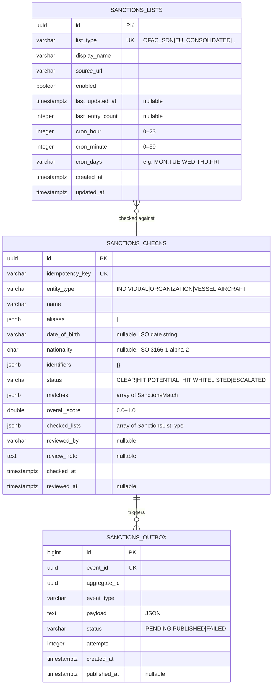

# Data

## Schema

Dedicated PostgreSQL schema `openbank_sanctions` in the `openbank` database (shared cluster, schema-per-service isolation).

## Migrations

Flyway, immutable historical scripts, forward-only:

| Script | What it does |
|---|---|
| `V1__create_sanctions.sql` | Table `sanctions_checks`, indexes on `status`, `name`, `overall_score` |
| `V2__create_sanctions_outbox.sql` | Table `sanctions_outbox` (transactional outbox pattern) |
| `V3__create_sanctions_lists.sql` | Table `sanctions_lists` with 6 seed rows (one per list type) |
| `V4__hibernate_sequences.sql` | Hibernate sequence table for surrogate key generation |

> Migrations are immutable after apply. Never alter a migration that has been applied to a production DB.

## Jurisdiction reference data

`sanctions_jurisdictions` (V21) holds embargoed and high-risk countries: `list_type`,
`source_list`, `country_code`, `measure` (`EMBARGO` | `HIGH_RISK`), `version`, `source_ref`,
`published_on`, `verified_on`, `active`. `list_type` is the screening-list slot a row is consulted
under; `source_list` is the publication it was copied from.

No source the service imports publishes these as a machine-readable feed — the `FATF_HIGH_RISK`
import is skipped as not entity based — so the rows are **versioned reference data**. They change
only through a reviewed Flyway migration: a new publication adds rows with a higher `version` and
retires the rows it supersedes (`active = false`), so the history stays in the table. A partial
unique index allows one active row per (list, publication, country). There is no endpoint that
writes this table: which countries are listed is a compliance decision recorded in the migration
that adds them.

| `source_list` | Loaded | Source |
|---|---|---|
| `EU_HIGH_RISK_THIRD_COUNTRIES` | V22 — 26 countries, all `HIGH_RISK` | Commission Delegated Regulation (EU) 2016/1675, Annex, consolidated version of 2026-01-29; compared with EUR-Lex on 2026-11-11 |
| `FATF_CALL_FOR_ACTION` | not loaded | the publisher's site could not be retrieved; no row is written from memory |
| `FATF_INCREASED_MONITORING` | not loaded | as above |

No row carries `EMBARGO`: the EU regulation requires enhanced due diligence, not a prohibition,
and no source loaded so far states a country embargo.

**Ageing.** These lists change several times a year and nothing imports them, so each row carries
the date of its publication (`published_on`) and the date it was last compared with the source
(`verified_on`). A re-verification that finds the source unchanged is still a migration — it
moves `verified_on`. The service publishes the age of both per `source_list`; see `05-operations`.

## Indexes

- `sanctions_checks(idempotency_key)` — UNIQUE, deduplication at insert
- `sanctions_checks(status)` — list hits/pending queries
- `sanctions_checks(name)` — partial text search
- `sanctions_checks(overall_score DESC)` — sort by risk score
- `sanctions_outbox(status, created_at ASC) WHERE status='PENDING'` — dispatcher poll
- `sanctions_outbox(aggregate_id)` — event lookup by check ID

## JSONB columns

`aliases`, `identifiers`, `matches`, and `checked_lists` are stored as JSONB in PostgreSQL for schema flexibility:

- `aliases` — `["alias1", "alias2"]`
- `identifiers` — `{"passport": "123456", "taxId": "CZ..."}`
- `matches` — array of `SanctionsMatch` objects (see domain model)
- `checked_lists` — `["OFAC_SDN", "EU_CONSOLIDATED", ...]`

Each of these columns holds an array or object, never a JSONB string. Older rows stored the JSON text wrapped as a JSONB string (`"[\"OFAC_SDN\"]"`); reading through `::text` then returned a quoted string Jackson could not bind, and `GET /api/v1/sanctions` answered 400. Migration V20 unwraps those values; `SanctionsLegacyJsonbStringIT` guards it.

## Retention

| Table | Retention | Reason |
|---|---|---|
| `sanctions_checks` | 10 years | AML/CFT statutory record requirement; AMLD 6 Art. 40 |
| `sanctions_lists` | forever | configuration, audit of list changes |
| `sanctions_outbox` | 30 days after PUBLISHED | troubleshooting, replay |

GDPR **right to erasure** does NOT apply to `sanctions_checks` — AML Directive overrides it (10 years). The name and identifiers are part of the legally required AML record.

## PII fields (GDPR)

| Field | Classification | Log masking |
|---|---|---|
| `name` | PII (direct identifier) | first 3 chars + `***` mask |
| `date_of_birth` | PII (direct identifier) | masked in logs |
| `nationality` | non-PII (country code only) | — |
| `identifiers` | PII (passport, taxId) | masked in logs |
| `aliases` | PII (alternative names) | masked in logs |

Lawful basis for processing: **Legal obligation** (Art. 6(1)(c) GDPR) + **AML Directive** obligation.

## Size estimates (1M screenings/year)

- `sanctions_checks` ~1M rows/year × ~2 KB (with JSONB) = **~2 GB/year** (10-year retention → ~20 GB)
- `sanctions_lists` — 6 rows, negligible
- `sanctions_outbox` (30-day window) ~80k rows × ~1 KB = **~80 MB** (low volume: not every payment triggers a check every time)

## Outbox retention (SENT rows)

`sanctions_outbox` is a delivery buffer, not a record. Rows that reached the broker (`status = 'SENT'`) are deleted once their `sent_at` is older than `openbank.outbox.retention.sent-days` (default **7**), by libs-runtime's shared `OutboxSentRetentionJob` (ADR-0329, ADR-0327 D8). The repository opts in by delegating `SentOutboxRetention` to `PanacheOutboxRetention`.

- Runs nightly (`openbank.outbox.retention.cron`, default `0 17 3 * * ?`) on every replica; each delete is bounded (`batch-size` 5 000, at most `max-batches` 200 per run), so a long-unpurged table drains over several nights.
- PENDING, FAILED, DISPATCHING and DEAD rows are never touched — DEAD rows are the producer-side DLQ.
- Replaying an event older than the window comes from the Kafka topic or audit-service, not from this table.
- Signals: `openbank_outbox_purged_total{service,status="SENT"}`, `openbank_outbox_purge_failed_total`, and workflow liveness `outbox-sent-retention`.
- Opt-out: `openbank.outbox.retention.enabled=false` (logs a WARN at boot). Don't lower `sent-days` below what any reader of SENT rows needs.

## JSONB screening payload retrieval

The `sanctions_checks` columns `aliases`, `identifiers`, `matches` and `checked_lists` remain JSONB with their existing defaults and NOT NULL constraints. The persistence entity keeps JSON text in Kotlin: SQL reads cast these columns to text, while writes cast the bound text to JSONB. The intermediate text cast on writes prevents a JSON document from being stored as a quoted JSON string. Database JSON validation remains in place; no payload-column type migration is required.

This mapping lets list, check-by-id and pending reads retrieve populated arrays and objects without changing the response fields or screening decisions. A real-PostgreSQL regression covers existing JSONB rows, reactive insert and update/reload with changed payloads, nullable metadata, malformed-JSON rejection and missing-id404. Positive HTTP tests use a test identity and do not prove production JWT or policy enforcement.

## List change publication state

Every `sanctions_lists.list_type` requires a row in `sanctions_change_publication`, including disabled lists and lists with no entries or pending journal changes. The row holds the publication fingerprint, refresh generation and active-refresh fence used before importing or draining changes. A migration that introduces a list must supply its publication state as well.

`V19__backfill_sanctions_publication_state.sql` initializes any missing list state with the table defaults. Existing fingerprints, generations and active-refresh flags are preserved by `ON CONFLICT (list_type) DO NOTHING`. Fresh-schema and V18-upgrade integration tests cover this invariant and replay with nondefault existing state.

Retain these additive control rows when rolling back application code, together with pending journal and outbox evidence. Removing a row can discard a generation, active fence or fingerprint and prevent older application code from publishing safely. Apply state repairs through forward migrations rather than manual recovery SQL.
